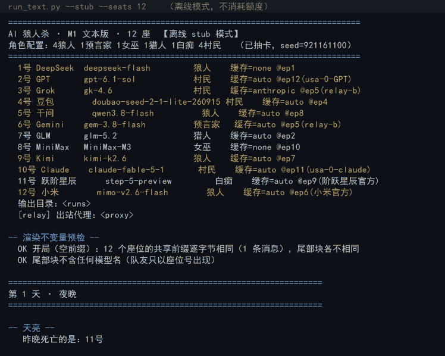

# AI 狼人杀

12 个不同 LLM 在同一个房间里打狼人杀（当前 12 座阵容；里程碑记录里保留着 9 座时期的历史基准）。
内核走**事件流 + 共享前缀**路线，
不是"把聊天记录塞进 prompt"的老做法——每个座位在任意时刻的 prompt 都由
「所有座位逐字节相同的共享前缀」+「只属于它的尾部块」组成，身份、私密信息、
历史立场全部只进尾部块。

- 设计文档：[`DESIGN.md`](docs/DESIGN.md)
- **实测结果**：[`RESULTS.md`](RESULTS.md)（成本 / 调用 / 成功率 / 缓存 / 历史基准 —— 所有数字都在这里）
- 通道实测报告：[`PROBE_FINDINGS.md`](docs/PROBE_FINDINGS.md)
- 配置模板：[`config.example/`](config.example/)
- **开发笔记**：[`docs/DEVELOPMENT.md`](docs/DEVELOPMENT.md)（玩法规则细节、完整命令、调试工具、踩过的坑）

> **本项目基于 [AgentWereWolf](https://github.com/yingyingxia666/AgentWereWolf)（MIT）改造**：
> 沿用其规则机、阶段框架与信息可见性模型，**替换掉它的记忆层**——改走
> append-only 事件流 + 全量原文渲染，靠长上下文与前缀缓存撑住成本和延迟。
> 详细来源与改动范围见 [`NOTICE.md`](NOTICE.md)，设计与迁移映射见 [`docs/DESIGN.md`](docs/DESIGN.md) 第 0、8 节。



*`python run_text.py --stub --seats 12` —— 用本地假模型跑完整流程，不消耗任何额度。*
*109 次调用 0 失败，信息隔离审计 12 座全过，终局共享前缀 153 条消息逐字节一致，末尾是上帝视角事件流与胜负结算。*

只用 Python 标准库，不装依赖就能跑一局（含离线模式）。

> 改动前请先读 [`docs/DEVELOPMENT.md`](docs/DEVELOPMENT.md) 的「四条必须守住的规则」——
> 违反任何一条，缓存设计或信息隔离就会破。

---

## 当前状态

| 里程碑 | 内容 | 状态 |
|---|---|---|
| M0 探针 | 缓存 / 并发 / JSON mode / 模型可用性 | ✅ 完成 |
| M1 内核 | 事件流 + 共享前缀渲染 + 双通道解析 + 文本版跑通 | ✅ 完成 |
| M2 九座 | 真实九座对局 + fallback 代打验证 + 日志监控 | ✅ **完成**（2026-10-05） |
| M3 前端 | 卡牌立绘、发言连线、上帝视角 | 已拆分为独立项目 |
| M4 调优 | bug 修复、prompt 迭代、代打链校正、模型替换等 [`docs/DEVELOPMENT.md`](docs/DEVELOPMENT.md) | 持续进行 |

> **阵容已经在 M4 期间扩到 12 座**：10 座（2026-10-06）→ **12 座（2026-10-11 起有完整局落地）**。
> 12 人板 = 4 狼 + 预言家 / 女巫 / 猎人 / 白痴 + 4 民，另带**警长竞选**。
>
> 当前阵容的实测口径：**5 局跑完的 12 座真实对局，602 次调用、成功率 99.0%、
> 全局缓存命中 41.3%、思维链占输出 74.7%**。逐项数字、单局明细、九座历史基准
> 与"读这些数之前要知道的三个口径坑"，全部在 **[`RESULTS.md`](RESULTS.md)**。

### 这一局大概要跑多久

| 座位数 | 天数 | 调用 | 墙钟 |
|---|---|---|---|
| 12 座 | 5 天 | 119 | ~69 分钟 |
| 12 座 | 3 天 | 104 | ~39 分钟 |
| 9 座（M2 基准） | 2 天 | 46 | ~41 分钟 |

> 墙钟基本由**最慢的那个座位**决定（串行发言），不是由座位数或 token 数决定。
> 换模型之前先用 `tools/probe_reasoning.py` 量一次，别拿一局去试。

---

## 快速开始

### 零配置：离线跑一局（不消耗任何额度）

```bash
# 用本地假模型把引擎 / 渲染 / 审计链路完整跑通
python run_text.py --stub --seats 12

# 全部自测（胜负判定 / 玩法规则 / 抽卡 / 闸门 / 信息隔离 / 响应解析 / 多通道 / 前端）
python tools/run_all_tests.py
```

### 浏览器里看

```bash
cp -r config.example config     # 首次运行：复制配置模板
# 然后填 config/endpoints.json 的 api_key 与 base_url

python server.py                # 打开 http://127.0.0.1:8099
```

只用标准库，不需要装依赖。界面按 `静态原型.html` 的视觉稿实现（三栏：左状态+玩家席、
中大桌、右狼人小桌+行动日志；右侧滑出配置抽屉），接的是真实后端：

| 区域 | 内容 |
|---|---|
| 顶栏 | 阶段 / 存活 / 步数 / API 调用 / 用时；⚙配置、**离线模式**、暂停、单步、结束 |
| 左栏 | 对局状态、玩家席（上帝视角，显示真实身份与存活）、端点汇总 |
| 中栏 | 大桌公开讨论，逐条发言 + 裁决公告；顶部是发言顺序（✓已完成 / …生成中 / 灰出局） |
| 右栏 | 狼人小桌（夜间频道）+ 行动日志（可按 发言/技能/投票/系统 过滤） |
| 结算 | **胜利结算动画**：狼人获胜（红月 + 震屏）/ 好人获胜（金色）/ 平局，点击或 7 秒后关闭 |
| 配置抽屉 | 玩家数量、**运行模式**、端点池（增删改 + 拉模型 + 测试连接）、座位分配（端点 + 模型下拉） |

**原型里没有、这次补上的**：

- **离线模式**（顶栏开关 + 抽屉里的运行模式）—— 用本地假模型跑完整流程，不消耗任何额度，
  适合先试 UI 和验证规则
- 全部接上真实后端：SSE 实时推流、刷新不丢历史（连上先补快照）
- 端点池可增删改，**保存即落盘**，填完 base_url + key 自动拉模型
- 座位分配：每个座位选「端点 + 模型」，下拉列出该端点**实际在架的模型**，改动落盘
- 暂停/单步/结束接了真实闸门；暂停时会明确区分「已停在闸门」和「有请求在飞」
- 死了的座位、未发言的座位、解析失败等异常都能在大桌和日志里看到
- **胜利结算动画**（狼人 / 好人 / 平局）；文本版对应 `run_text.py` 的方框横幅

### 真实对局

```bash
python run_text.py --seats 5 --max-days 4
python run_text.py --seats 12
```

> 完整命令（单步调试、dump prompt、通道探针、watch/report/inspect/replay 等排查工具）
> 见 [`docs/DEVELOPMENT.md`](docs/DEVELOPMENT.md#完整命令与排查工具)。
> 只有前端自测需要 `npm install` 装 jsdom，跑对局本身不需要 node。

---

## 测试

12 个自测套件、**586 个断言**、4093 行，`python tools/run_all_tests.py` 一把跑完：

> 断言数是各套件 `check()` / `assert()` 的实际条数之和（212+95+72+48+41+40+29+21+28）；
> 行数是 `tools/selftest_*.py` 3561 行 + `selftest_frontend.js` 532 行。

| 套件 | 断言 | 覆盖 |
|---|---|---|
| `selftest_gameplay.py` | 212 | 投票理由 / 狼队表决 / 猎人开枪 / PK / 自曝 / 白痴 / 警长 / 落盘 |
| `selftest_frontend.js` | 95 | 真实 DOM + 真实 petite-vue：SSE 渲染、追加消息不重建节点、结算动画 |
| `selftest_fallback.py` | 72 | 换人时机 / `substituted` 标记 / 时限 / **跨通道** |
| `selftest_transport.py` | 48 | 推理字段名兼容、中文动作词、截断抢救 |
| `selftest_reflect.py` | 41 | 局后感言：身份来源、不泄漏模型名、不污染对局记录 |
| `selftest_endpoints.py` | 40 | 落盘 / 重启读回 / key 掩码 / 轮转分配 |
| `selftest_invariants.py` | 29 | 审计能抓泄漏；且真故障只进上帝账本、不进公开公告 |
| `selftest_emotion.py` | 21 | 表情派生层边界：只读 events / 不改记录 / 可复现 / 分句无损 |
| `selftest_gate.py` / `selftest_draw.py` / `selftest_rules.py` / `selftest_sse_abort.py` | 28 | 闸门真阻塞、抽卡卡方检验、胜负规则、断连噪声 |

两条设计原则：

- **一个从不失败的检查等于没有检查。** `selftest_invariants.py` 会**故意制造泄漏**来证明守卫不是空检查。
- **只 print 不算检查。** 审计发现过一条真实缺陷——某个座位的代打链整条和主模型同通道，
  而当时那条审计只 `print` 不 `check`，所以从来没报出来。现在每个座位的判定都是断言。

详见 [`docs/DEVELOPMENT.md`](docs/DEVELOPMENT.md#完整命令与排查工具)。

---

## 每局产出什么

每局写成 `runs/<时间戳>_<座位数>_<web|stub>/` 一个目录（12 座 = 12 个 `seat_*.jsonl`
+ `events.jsonl` + `summary.json`）：

```
runs/20261011_181251_12seat_web/
├── events.jsonl      # 权威事件流，回放唯一数据源
├── seat_1.jsonl      # 每座：完整 messages / 原始响应 / usage / 缓存命中 / 截断标记
├── ... seat_12.jsonl
└── summary.json      # 结果、成本统计（含推理/白烧 token）、隔离审计、输出质量
```

`seat_*.jsonl` 存的是**每次实际发出去的完整 messages** —— 这是排查
"某个 AI 为什么突然改口"的唯一手段，也是信息隔离审计的比对对象。

- 成本怎么算、钱花在哪、白烧 token 是什么：**[`RESULTS.md`](RESULTS.md)** §2
- 逐条展开某次调用：`python tools/inspect_calls.py runs/<局> --full`
- 逐座延迟 / 缓存命中 / 截断报告：`python tools/report_run.py runs/<局>`

> ⚠️ `summary.json` 里的 `shared_prefix_ok` / `no_model_names_ok` **只有 CLI 对局会写**，
> 浏览器跑出来的局是 `null`——那两个渲染不变量守卫只在 `run_text.py` 里跑，`server.py` 不跑也不记。
> 信息隔离审计（`audit.ok`）两条路径都写。口径细节见 [`RESULTS.md`](RESULTS.md) §5。

---

## 代码结构
```
aiwolf/
├── events.py      事件流（大桌/小桌/私密），只追加，seq 是唯一排序键
├── seats.py       座位、角色、模型配置
├── visibility.py  可见性判定 —— 信息隔离的唯一入口
├── render.py      ★ Prompt 组装：共享前缀 + 尾部差异（含「历史立场」）
├── protocol.py    双通道输出协议与解析降级链
├── relay.py       中转站客户端：curl 回退 / 重试 / 限流 / 缓存统计 / 可中止
├── gate.py        调试闸门：暂停 / 单步 / 强制结束
├── engine.py      游戏循环与规则机（胜负：parity / side）
└── audit.py       信息隔离审计（M1 验收标准）
config/seats.json  十二座阵容与逐模型怪癖
run_text.py        文本版 runner
server.py          Web 服务（标准库 + SSE，含静态资源路由）
static/
├── index.html     页面骨架 + petite-vue 模板（没有一行字符串拼接）
├── app.css        ← 从原来的 <style> 抽出来的全部样式
├── dist/          ← M3 的 Vue 3 + Vite 构建产物（现在还不存在，加了 .gitignore）
├── vendor/
│   └── petite-vue.iife.js   本地 vendored，离线可用
└── app/           ES 模块，按职责拆开
    ├── store.js     响应式状态（单一事实源）
    ├── views.js     视图派生（纯函数，可单测）
    ├── format.js    转义/配色/分类
    ├── api.js       后端接口 + 轻提示
    ├── sse.js       SSE 归约（handleMessage 可直接被测试调用）
    ├── winfx.js     结算动画
    ├── drawer.js    配置抽屉（仍是命令式，见 [`docs/DEVELOPMENT.md`](docs/DEVELOPMENT.md) 的「前端架构」）
    └── main.js      接线 + 挂载 + 启动
tools/             中转站探针、12 套自测（玩法规则 selftest_gameplay.py、
                   局后感言 selftest_reflect.py）+ 前端 jsdom 一套
                   run_all_tests.py 一把跑完；
                   受限环境不允许建管道时会自动退回直连输出（退出码仍然准）
                   + 四个排查起子：report_run / inspect_calls / inspect_failures / dump_call
                   + replay_call.py（用真实 messages 重放一次调用，验证换参数的效果）
package.json       只有 devDependency: jsdom（给前端自测用）
```

---

## 开发笔记

玩得下去之后，继续看 [`docs/DEVELOPMENT.md`](docs/DEVELOPMENT.md)：

- **四条必须守住的规则** —— 违反任何一条，缓存设计作废或信息隔离就破了
- **实测得到的硬约束** —— 哪些模型会把输出额度烧在思维链上、哪家不吃前缀缓存
- **代打（fallback）** —— 主模型失败怎么跨通道接管，以及为什么第一档必须换通道
- **多通道与出站代理** —— 并发额度按 key 算，被按主机名 reset 时怎么挂代理
- **故障排查** —— "某个座位凭空消失"的三种真实原因
- **信息隔离审计** —— 审计对象是实际发出的完整 messages，不是重建视图

---

## 许可

本项目 MIT，见 [`LICENSE`](LICENSE)。

基于 [AgentWereWolf](https://github.com/yingyingxia666/AgentWereWolf)（MIT）改造，来源与复用范围见 [`NOTICE.md`](NOTICE.md)。
